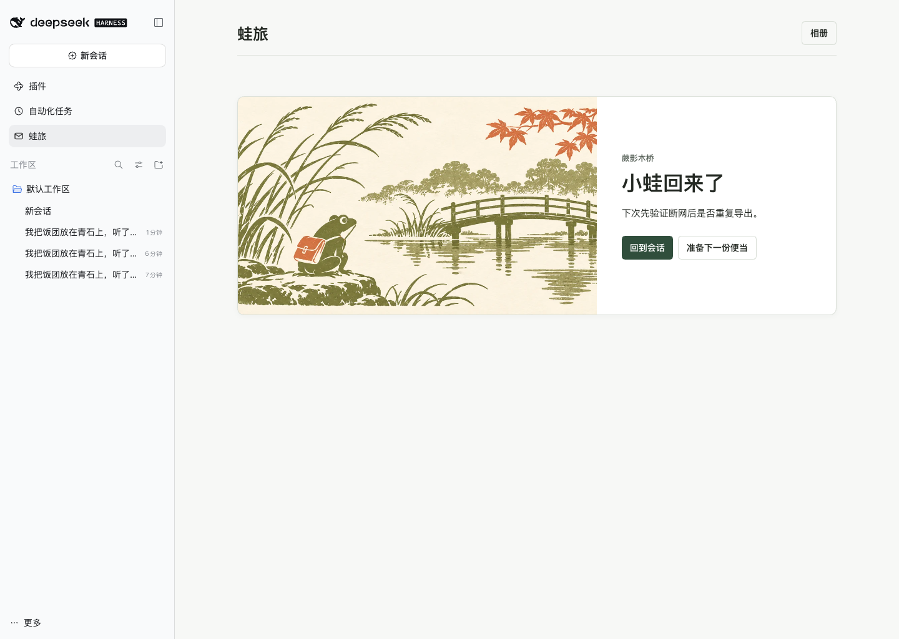

# 蛙旅 · DSH Travel Frog

DeepSeek Harness 里的旅行伙伴。给小蛙备一份便当，等它自己出门，再回来收一张明信片。



- 从侧栏打开 **蛙旅**，点 **备好便当**。小蛙会自行出门，离开页面后时间也会继续推进。
- 也可以从会话顶部点 **给小蛙备便当**，留一句下次想做的事。明信片上的 **回到会话** 会打开原会话。
- 旧明信片放在右上角的 **相册**，可查看正文并导入或导出存档。

## 安装

需要 Node.js ≥24.9。已在 DeepSeek Harness **0.2.1-rc.2 Web** 验证。浏览器需支持 Web Locks，使用 localhost 或 HTTPS。

```sh
pnpm install --frozen-lockfile
pnpm pack --pack-destination artifacts
dsh plugin --profile web add ./artifacts/dsh-travel-frog-0.2.1.tgz
dsh web
```

已启动的 DSH 实例需重启，才能加载新版本。

## 存档

旅行和明信片保存在当前浏览器、当前 DSH 地址下。旧版存档可继续读取。会话入口只保存选定会话的编号和你填写的备注。旅行使用本地时间，不调用模型。

## 开发

```sh
pnpm check
```

`core.js` 负责旅行和存档规则。`client-source.js`、`client.css` 和原创 WebP 插画由 `tools/build.mjs` 合并到 DSH 浏览器模块 `client.js`。

[验证记录](docs/verification.md)

## 卸载

```sh
dsh plugin --profile web remove dsh-travel-frog
```

重启 DSH。浏览器存档保留，可以在卸载前从相册导出或重置。

MIT。信封图标来自 Tabler Icons，随安装包附带其 MIT 许可。蛙旅的插画为本项目制作，与《旅行青蛙》及 DeepSeek 官方无隶属关系。
